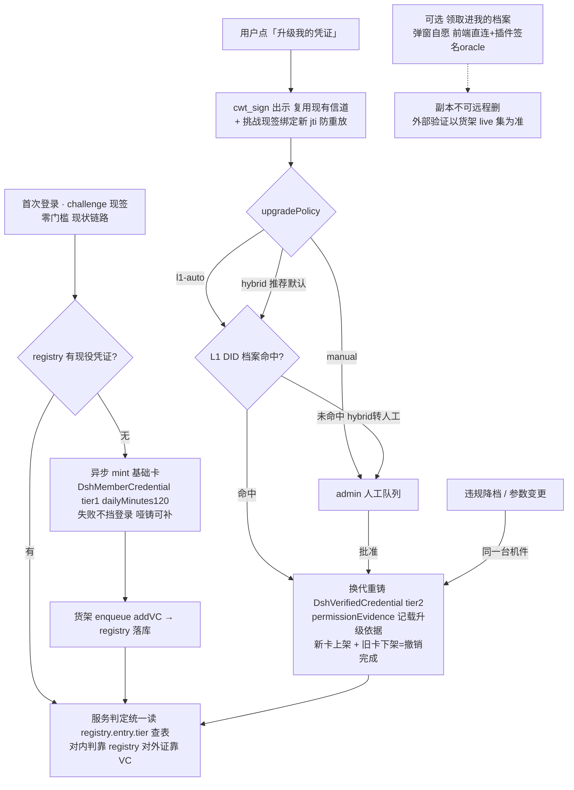
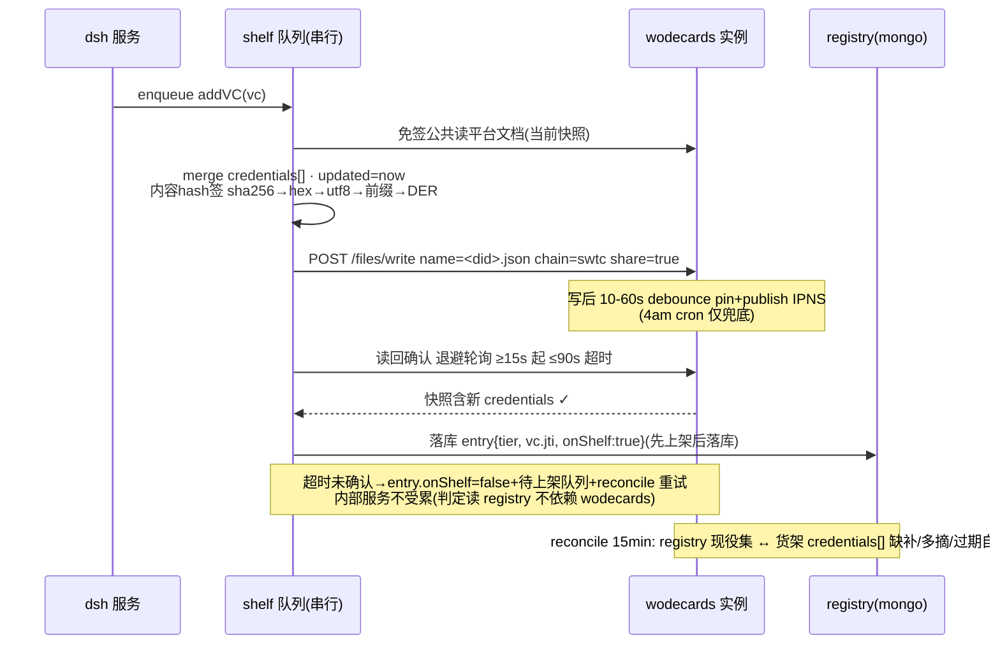

# Dsh DID/VC 实施方案手册 · 定稿 v1.2

> ⚠️ **凭证模型部分已被 [`credential-v1.4.md`](./credential-v1.4.md) 取代**（2026-10-19 上线：互斥单台账 did/解限双凭证、登录续发、链上验真、stale 同步、解限术语）。本手册保留价值：wodecards 生态调研结论、预验证记录（§5）、私钥红线（§3.4）、relay 文件签与档案路径口径。阅读顺序：先 v1.4，再回看本篇考证细节。

> **状态：步骤 1-6 已实施 + v1.2 用户持有改版已落地（2026-10，dev 实例 E2E 全通，844/844 测试全绿）**。v1.2=用户拍板改版（§10）：凭证主副本入用户手中、账本为效力权威、货架降为可选公示副本、平台补展示与管理面。本版取代此前所有讨论形态（闭环 JWT 草案 / 挂法 A/B 二选一 / 双投影方案）。依据一：wodecards 全仓源码复核（`~/.dshWorkspace/wodecards`，backend 全量 + docs/DID 全量 + did_DApp 关键链路 + vc-compat 规格）；依据二：**预验证两轮全绿**（ethr 版+SWTC 版各 8/8：造钥→锚文档→上传→公共读→真库 mint LD proof→挂架→官方 resolver 外部验签 verified:true→下架清零，dev 8550；工件 `~/.dshWorkspace/vc-preflight/`）+ **prod 实例试挂/查询页渲染/撤架走通**（`ipfsserver.ccda.ooo`，一次性测试钥，阅后即焚）。v1.0→v1.1 增量=预验证协议回写（§5.1-5.3）+ issuer 链族 SWTC 化（ADR-18）+ 生命周期/管线流程图（§1/§2）。
> 上游：`identity-auth-current.md`（基线）、`ccdao-did-integration.md`（生态调研+§8 勘误）、`cwt-access-design.md`（零门槛决策，维持）。

## 0. 决策速览（定稿）

| #   | 决定         | 内容                                                                                                                                                 | 依据     |
| --- | ------------ | ---------------------------------------------------------------------------------------------------------------------------------------------------- | -------- |
| 1   | **分层发卡** | 首次使用自动铸基础卡 `DshMemberCredential`(tier:1)；CWT 出示+档案判定通过后**换代重铸**升级卡 `DshVerifiedCredential`(tier:2 免限)。服务按 tier 查表 | ADR-11   |
| 2   | 凭证住所     | **平台货架为主**：现役凭证挂平台自己的 DID 文档 `credentials[]`（在架=有效，取下=撤销，wodecards 生态原生语义）；用户文档副本为可选「领取」          | ADR-7/14 |
| 3   | 凭证格式     | **统一 JSON-LD VC**（JWT 投影砍掉）；`@context` **内联**（不引远程 URL——ccda.ooo 404 教训）；词汇命名空间 `urn:dsh:`                                 | ADR-8/15 |
| 4   | 签发密钥     | 部署者提供（secp256k1 PEM/hex），程序零生成；缺钥=发卡功能未启用，登录等一切照常                                                                     | ADR-2    |
| 5   | 平台身份     | 同一把钥两个表达：`did:swtc:j1U…`（wodecards 货架/凭证 issuer，**★链族=SWTC，用户拍板**）+ `did:web:<host>`（闭环投影，占位可换）                    | ADR-6/18 |
| 6   | 升级闸门     | config `upgradePolicy: 'l1-auto' \| 'manual' \| 'hybrid'`——CWT 出示本身零门槛，必须有判定件                                                          | ADR-16   |
| 7   | holder 绑定  | 现有挑战机器 `purpose\|addr\|nonce\|jti` = VP 等价件（出示/领取确认都走它）                                                                          | ADR-5    |
| 8   | 撤销         | 换代重铸（新 jti 上架+旧条目下架），**不建 status 位图**（货架即 status list）                                                                       | ADR-4    |
| 9   | 内部判定     | 服务区分读 registry 的 tier（性能/可用性不依赖 wodecards）；VC 是**对外证书**，对内判、对外证                                                        | ADR-17   |
| 10  | 零门槛       | L0 登录不受任何影响；人人有卡（基础卡自动），级别靠升级                                                                                              | 全文     |

## 1. 形态总览（一张图）



要点不变：人人有卡（基础卡自动）、级别靠升级、换代重铸三径同件（升/降/重签）、服务按 tier 查表、货架即 status list。

## 2. 生命周期与数据流

```
━━ 写路径（唯一复杂点：货架是单文档，操作必须串行）━━
mint(服务端 @jccdex/did issueCredential，平台私钥签 proof)
  → shelf.enqueue(addVC)     读平台文档→merge credentials[]→内容hash签→POST /files/write
  → 成功后 registry[addr] = { tier, vc{ jti, ldvc, onShelf:true, mintedAt } }
    顺序纪律：先上架后落库——外部世界看见的永远不少于账本
  → 上架失败：entry.vc.onShelf=false + 待上架队列 + reconcile 重试（内部服务不受累）

━━ 读路径 ━━
内部出示：registry 三问（签名/exp/jti 比对），全程内存，wodecards 挂了照常服务
外部验证方：免签读平台文档 → 取凭证 → resolve issuer 锚条目（平台文档自身）
            → verifyCredential（同库验 proof）→ exp → "在架即活"完成
领取（可选）：见 §6.5，前端直连 IPFS 服务 + 插件签名 oracle

━━ 换代/撤销 ━━
revoke：registry 判死 + shelf.removeVC(jti)（用户已领取的副本判不死没关系——
        外部验证语义钉死"以货架 live 集为准"，文案在领取时告知）
reconcile(15min)：registry 现役集 ↔ 货架 credentials[]，缺补/多摘/积压告警；
        过期凭证自动摘（维持"在架=有效"单调性；领取副本不参与）
```



## 3. 准备工作

1. 依赖：`npm i @jccdex/did@0.3.2`（LD mint/verify 主引擎；JSON-LD canonicalize 禁止自研）+ `@noble/curves`（文件内容签名/验，唯一轻量件）。交叉验证测试装 0.2.11 对照（插件同款）。
2. 部署者钥（同前）：`openssl ecparam -name secp256k1 -genkey -noout -out data/keys/issuer.key`；0600。
3. config 新段：
   ```jsonc
   "issuer": { "keyPath": "data/keys/issuer.key", "vcTtlDays": 365, "legacyKids": [] },
   "shelf":  { "rpcBaseURL": "https://ipfsserver.ccda.ooo",  // ★正式实例（2026-08 实测存活，写入=app.ccda.ooo 查询页公开可见）
                                                    // dev 实例 wodecards.wh.jccdex.cn:8550 仅联调用（brand/index.ts L72-73 实证两实例）
                                                    // 亦可自建（wodecards 有 dockerfile）——rpcBaseURL 的选择=公示范围的选择
               "chain": "swtc" },                                      // ★平台 DID 族别=SWTC（ADR-18），一经使用不可改
   "vc":     { "tiers": { "1": { "dailyMinutes": 120 }, "2": { "dailyMinutes": null } },
               "upgradePolicy": "hybrid" }   // ★v1.1.1 勘误：段名 vc.tiers——早期草案 "tiers" 与存量容器资源规格段撞车
   ```
   ✅ 已落地（准备工作 2026-08）：config.js 默认段 + config.json.example + 本地 config.json（dev 实例）；`SIGN_PURPOSE.VC_PRESENT` 已加；rsync 对 `data/keys/` 无条件排除（UPLOAD_DATA=1 也不碰现场钥）；开发占位钥已生成（data/keys/issuer.key 0600，正式部署由部署者替换）；开业脚本 `scripts/shelf-open.mjs`（dry-run 默认，--yes 才写；已用 dev 钥干跑验证派生链）。
4. `SIGN_PURPOSE` 增 `VC_PRESENT`；`rsync-upload.sh` 排除 `data/keys/` 核实（现场密钥不可被覆盖——毁灭级）。
5. 平台锚文档开业脚本（一次性）：钥→`did:swtc:j…`（= `Keypairs.deriveAddress(压缩33B公钥hex)`，★v1.1.2 勘误：**swtc 族表单/地址一律压缩形态**——ripple 标准 account_id=ripemd160(sha256(压缩公钥))、服务端 address.ts 注释 "Accepts SEC1 compressed"，与插件钱包 `seed→deriveKeypair→压缩public→地址` 生态推导实测同串；此前预验证误以未压缩形态两端自洽通过（8/8 但地址与生态不同族），已改压缩重验 A→H 全绿）→文档{ **`created`/`updated`(ISO) 必填★**（app.ccda.ooo 查询页渲染文档头时间，缺了整页时间 nan——prod 试挂实测踩中），#key-1（**publicKeyBase58 必填**——验签链只认它）, authentication/assertionMethod, service:[], credentials:[] }→上传 share 路径。此后货架文档即此文档（`credentials[]` 随运营增删）。
6. 上线 checklist 债：HTTPS（did:web 投影与 cookie 的共同前提；不阻塞货架主线）；**IPFS 服务 CORS** 允许 dsh origin（领取流前端直连需要——did_DApp 同源部署没暴露过这问题，实测见 §8）。

## 4. 实施步骤（七步，独立可合入，工作量明细见 §9；预验证已吸收协议考古与实例联调风险）

| 步   | 内容                                                                                                                                                                                                                                                 | 文件                                                | 验收                                                                                                                 | 行为变化              |
| ---- | ---------------------------------------------------------------------------------------------------------------------------------------------------------------------------------------------------------------------------------------------------- | --------------------------------------------------- | -------------------------------------------------------------------------------------------------------------------- | --------------------- |
| 1 ✅ | issuer.service：钥加载（**PEM/hex/ss-seed 三格式**/secp256k1 曲线校验）/指纹 kid/双 DID 表达（did:web 域名才启用）/锚文档模板/`signFileContent`                                                                                                      | `src/services/issuer.service.js`                    | 13 单测：自签自验/他曲线拒入/三格式等价/哑火态                                                                       | 零                    |
| 2 ✅ | shelf.service：读写/串行队列/退避轮询（confirmSnapshot 15s→60s 步进 ≤90s）/pending 计数                                                                                                                                                              | `src/services/shelf.service.js`                     | 9 单测 + dev 真实例全环（开业→挂→确认→撤→清零）                                                                      | 零                    |
| 3 ✅ | mint LD VC + 首登挂钩（connect 尾部 fire-and-forget，`vc.autoMint` 闸门默认 false）+ 补铸脚本 `scripts/vc-backfill.mjs`                                                                                                                              | `src/services/vc.service.js`                        | 8 单测 + dev E2E（铸→架→外部 verify true→撤）；**深 require 必须走文件路径**（0.3.2 exports 拦裸标识符，实施新踩坑） | 只写不读              |
| 4 ✅ | 升级流程：`/vc-upgrade`（cwt 出示复用，verify 不 verifyForAccess）+ 三策略（manual 恒转队列=出示件不越权）+ approve→重铸/revoke→降档挂钩 + `ensureUsageAllowed` 查表（**cfg 优先、tier2 null 压顶、cfg 未配表接管**=平滑演进）+ admin `/vc/restripe` | user.service/cwt-admin/routes                       | 10 单测三策略矩阵 + 旧 usage-limit 回归                                                                              | tier 生效（默认无感） |
| 5 ✅ | L1 档案判定（verificationMethod≥1 且 authentication 非空=真人档案）+ 15min 缓存 + 3s 超时静默 + 缺席短缓存防雷暴                                                                                                                                     | `src/services/did.service.js`                       | 7 单测三态 + dev 真网络双态验证                                                                                      | 只读                  |
| 6 ✅ | `/vc-present-challenge`+`/vc-present`（挑战 binding=现役 jti；三问=签名/exp/jti；供卡走 registry 留底=断网可服务）+ presentMode off/registry 回滚位 + **reconcile 双向对账**（过期摘/无主摘/留底补架——E2E 实证只补不摘会滞留）                       | user.routes + `reconcileVcShelf` + server.js 定时器 | 4 单测 + dev E2E（真签挑战/补架检出）                                                                                | 开关控制              |
| 7    | 领取前端（可选件，最后上）：§6.5 流程 + 70s 重读自愈 + 文案三条                                                                                                                                                                                      | `useClaim.js`                                       | CORS 实测/竞态用例                                                                                                   | 纯用户主动            |

上线序列照旧：默认全哑（`presentMode:'registry'`+无人升级）→ 配钥开业 → 存量补基础卡 → `hybrid` 放开升级 → 灰度观察 → 收口。**回滚位仍是单一 config**。

## 5. 核心代码参考

### 5.1 文件签名口径（逐字节实证，勿再猜）

```js
// 来源：@jccdex/ipfs-rpc-client@0.1.8 dist/utils/signature.js + 服务端 verify.ts 互证
// message = sha256(文档字节) 的 bytesToHex 小写 hex 串 → utf8 字节
// 签名   = sha256( "\x19IPFS Signed Message:\n" + message.length + message字节 ) 后
//          secp256k1 ECDSA，输出 DER hex（toHex("der")）
// publicKey = 未压缩 04… hex（getPublicKey(priv) 默认非压缩）
// 上传   POST {base}/v0/api/ipfs/files/write  multipart:
//        file(字节) · name="<did>.json"(★必须带 .json，服务端扩展白名单否则拒) ·
//        publicKey: **swtc 族=压缩 33B hex（v1.1.2 勘误）**；ethr 族才用 04…未压缩 ·
//        signature(DER hex) · chain=swtc · share="true"
// 公共读 POST {base}/v0/api/ipfs/shared/files/read { file:"/<sha256hex(地址串)[0:2]>/<[2:4]>/<地址串原样>/shared/<did>.json" }
//        地址串：swtc 原样（deriveAddress(压缩33B)——★v1.1.2 勘误，swtc 族表单 publicKey 也一律压缩，非 04 未压缩）；ethr 族才用 04…未压缩+EIP-55
//        ★前导斜杠必须有（isSharedPath 数段深度）；★无 mfs 前缀（IPNS 根即 mfs 目录）；无鉴权
// ★★ 以上口径已整链实证：ethr 版+swtc 版各 8/8 全绿（dev 8550，见 §8 首行）
signFileContent(bytes) {
  const hash = createHash('sha256').update(bytes).digest('hex')
  const msg  = Buffer.from(hash, 'utf8')
  const pre  = Buffer.from('\u0019IPFS Signed Message:\n' + msg.length, 'utf8')
  const z    = createHash('sha256').update(Buffer.concat([pre, msg])).digest()
  return secp256k1.sign(z, this.issuer.privHex).toHex('der')   // ← der hex，非 compact
}
```

### 5.2 mint（LD 形态定样：内联 context + permissionEvidence）

```js
// ★ Node24 装载定案（实证）：@jccdex/did 的 barrel import 必炸（vc-issue/vc-verify 拉
//   jsonld5→esm@3.2.25 死包 + noble2 ESM-only）。深度 require 四件套全部 Node24 可载：
const D = '@jccdex/did/'
const { issueCredential, verifyCredential } = require(D + 'lib/credential-sdk/credentials.js')
const Secp256k1Keypair = require(D + 'lib/credential-sdk/keypairs/keypair-secp256k1.js').default
const { createDocumentLoader, registerContextUrl } = require(D + 'lib/context-loader.js')
const { EthrDidResolver } = require(D + 'lib/resolver.js') // + @jccdex/ipfs-rpc-client
registerContextUrl('https://w3id.org/security/suites/secp256k1-2019/v1', SUITE_CTX_LOCAL_COPY)
//   （库缓存有 credentials/v1/security/v1 等，唯独 suite-2019 URL 无 → 落盘本地副本，运行零外网）
// getKeyDoc 手打 7 行（vc/helpers.js 带 esm 炸弹）；keypair 传 Secp256k1Keypair **包装实例**
//   （signerFactory 要 keypair.keyPair.sign + keypair.constructor.hash，不是 elliptic 裸钥）
// 构造：new Secp256k1Keypair(Buffer.from(privHex,'hex'), 'private')   // ★要 bytes 不要 hex 串

const DSH_CTX = {
  // ★ 纯平 term→URL 词表（safe mode 不吃嵌套 @id 定义/相对引用）
  DshMemberCredential: 'urn:dsh:credential:DshMemberCredential',
  DshVerifiedCredential: 'urn:dsh:credential:DshVerifiedCredential',
  permissionEvidence: 'urn:dsh:credential#permissionEvidence',
  tier: 'urn:dsh:credential#tier',
  verifiedVia: 'urn:dsh:credential#verifiedVia',
  dailyMinutes: 'urn:dsh:credential#dailyMinutes',
  DshShelfStatus2026: 'urn:dsh:DshShelfStatus2026', // ★ status 类型必须入词表，否则 safe mode 拒相对 @type
}
async function mintTierVC(issuer, entry, tier, evidence = null) {
  const keyDoc = getKeyDoc(issuer.shelfDid, issuer.keypair) // did:swtc:j1U…#key-1
  const descriptor = {
    '@context': ['https://www.w3.org/2018/credentials/v1', DSH_CTX], // suite ctx 由 addSuiteContext 自动追加（本地注册表命中）
    id: `urn:dsh:credential:${tier}:${entry.address}:${jtiStamp()}`, // id 即 jti 载体
    type: ['VerifiableCredential', tier === 2 ? 'DshVerifiedCredential' : 'DshMemberCredential'],
    issuer: issuer.shelfDid,
    issuanceDate: now(),
    expirationDate: plus(ttlDays), // exp 强制（wodecards 安全规则原文）
    credentialSubject: {
      id: `did:swtc:${entry.address}`,
      tier,
      dailyMinutes: tierConfig[tier].dailyMinutes,
      ...(evidence ? { permissionEvidence: evidence.refUri } : {}),
    }, // ★ 实证：值用完整 urn: 串；
    //   嵌套对象形态（Manufacturer 的 {credentialId,relationship}）须在 DSH_CTX 加子词表（CCDAO accessRestrictions 模式），二选一，别裸放
    credentialStatus: { type: 'DshShelfStatus2026', id: `${issuer.shelfDid}#credentials` }, // 在架即活
  }
  return issueCredential(
    keyDoc,
    descriptor,
    true,
    createDocumentLoader(),
    null,
    undefined,
    null,
    true,
    'jsonld',
  ) // ★loader 显式传（含本地注册表）；expansionMap 传 null——jsonld-signatures11 拒收非 null
}
// 升级调用：evidence = { credentialId: cwtPresentedJtiOrProfileRef, note: 'l1-profile-hit'|'admin-approved' }
// ★ 锚文档 verificationMethod 模板（实证定案）：
// { id: `${shelfDid}#key-1`, type: 'EcdsaSecp256k1VerificationKey2019', controller: shelfDid,
//   publicKeyBase58: bs58(compressedPubkeyBytes) }   ← ★验签链只认 publicKeyBase58/base64，
//   publicKeyHex 仅展示用不参与 verify（docs/DID 样例误导，实证纠偏）
```

### 5.3 货架操作（串行 + upsert 幂等）

```js
enqueue(mutate) { this.queue = this.queue.then(async () => {
  const doc = (await this.get(this.issuer.shelfDid)) ?? this.anchorDoc()
  mutate(doc); doc.updated = new Date().toISOString()   // ★每次上架刷 updated（生态 publish 同款语义）
  await this.put(this.issuer.shelfDid, doc)   // put=§5.1 signFileContent+multipart
}).catch(e => { this.pending++; log.warn('货架失败→待上架队列', e) }) }
// ★ 实证：写后服务端 debounce 10-60s 才 pin+publish IPNS；shared 读走快照——
//   写后即读必 miss。读回确认/reconcile 按 ≥15s 退避轮询（≤90s 超时判 pending），不是 bug 是时序。
//   ★E2E 实战复现（下架侧同款）：removeVC 入队读到滞后快照缺目标 → 幂等 noop → 卡滞留——
//     reconcile 必须双向对账按 registry 为准（缺补/多摘），不能只补不摘。
addVC    = vc   => this.enqueue(d => upsertById(d.credentials ??= [], vc))
removeVC = jti  => this.enqueue(d => d.credentials = d.credentials.filter(c => c.id !== jti))
```

### 5.4 挂钩与判定（三处）

```js
// ① 首次登录（用户记录创建处，异步队列）：tier=1 哑铸；失败仅告警
// ② 升级（cwt 出示链路末端）：policy 判定过 → mint(tier:2, evidence) → addVC 新 → removeVC 旧 → entry.tier=2
// ③ 服务判定表：dailyMinutes = tiers[entry.tier ?? 1].dailyMinutes —— 网关/配额/前端徽标统一查
```

### 5.5 领取（前端，可选件）

```js
// 全程不碰 did_issueCredential——proof 已平台签好；用户只签"自己文档的上传"（知情同意弹窗=写档案确认）
// ① 免签读用户文档（无则先建）② merge entry.vc.ldvc 进 credentials[] ③ ipfs_personalSign(hashBytes)
// ④ 直连 files/write 上传 ⑤ POST /vc-bound { jti } 回执 ⑥ 70s 后重读校验未被插件轮询踩掉，被踩重领一次
// 文案三条：公开可读 / 平台撤销不抹副本（以货架为准）/ 依赖 wodecards 在线
```

## 6. ADR（定稿版，含翻案记录）

**ADR-1 代管为体、副本为用**：事实源 registry；货架=对外投影；用户文档=可选副本。原"localStorage 副本"降级为缓存行为（领取前预览用），不再是住所。
**ADR-2 部署者供钥**（不变）+ 程序检查：钥地址出现在用户/registry 名单则拒载。
**ADR-3 kid/身份指纹**：货架 DID 由平台钥单向派生（swtc 族=`deriveAddress(压缩33Bhex)`（v1.1.2 勘误），见 ADR-18 换族记录），货架身份与平台身份同源一钥双表达。
**ADR-4 换代即撤销**：jti 换代 + 旧条目下架；无位图无端点。**货架 live 集 = status list**（生态原生语义，Manufacturer 蓝图同向）。
**ADR-5 挑战机当 VP**：`purpose|addr|nonce|jti` 绑定，出示/领取回执共用。
**ADR-6 did:web 占位可换**：投影身份；重 mint 幂等无赌注。
**ADR-7【翻案】货架主干**：原"主链不过 IPFS"被 wodecards 源码证伪其前提（保管位存在 `bindVcToDid` L343、覆盖制可撤 `deleteCredentialFromDID` L675、机构签发本就在 issuer 环境——Manufacturer 蓝图）。翻案为：平台文档货架为主干，双轨守红线——**内部判定永不依赖货架在线**（红线 1 换形态守住了：wodecards 挂=用户照常进容器，仅外部验证暂停）。
**ADR-8【翻案】统一 LD、砍 JWT**：生态消费端（服务端 `validateFileAccessVC`、did_DApp 全套、0.2.11↔0.3.2 交叉）只认 LD；闭环内部三问对 LD/JWT 无差别，没必要为"闭环简单"养两套凭证。
**ADR-9 L1 升格为判定件**：从"徽标可选"变为升级闸门组件（hybrid 策略），但**仍不碰准入门**——零门槛不动摇。
**ADR-10 双时刻并存**：CWT 申请出示与持证使用互不取代。
**ADR-11【新增】分层发卡**：人人有卡、级别靠换代升级；服务区分从布尔变类型矩阵；"覆盖升级"=已有机件（换代重铸），零新发明。采纳的生态蓝图证据：`02.Manufacturer DID Flow.md`（机构签 AdminCredential/roleUri/exp 强制/根账号吊销，同构先例）。
**ADR-12【新增】permissionEvidence 引用链**：升级卡记录"凭谁升级"（CWT 出示/档案命中）， Manufacturer 词汇直接借用（`relationship:'verified_via'`），分级依据对外可验。
**ADR-13【新增】VDR 链锚=远期**：平台三件套（开业登记交易/checkpoint 批注 hash/重建扫描）记名不排期；用户级逐凭证上链**否决**（签名异步+链确认杀死发放实时性，双花 TODO 原样躺着）。SWTC 链活性实测前置。
**ADR-14【新增】领取可选不默认**：弹窗+公开语义决定它是主动作；基础卡不值得打扰新用户（只升过级的人有领取动机）。
**ADR-15【新增】@context 内联**：远程词汇 URL 已被生态自己 404 实证会死；内联=验证零外链。
**ADR-16【新增】升级闸门必须有判定件**：CWT 自签零成本，无判定件的自动升级=批量薅免限；`upgradePolicy` 三态，默认 hybrid。
**ADR-17 对内判、对外证**：tier 查表读 registry（快、独立），VC 只服务外部世界——**两侧永远由同一次换代保持同步**（先上架后落库顺序的反向表述：落库即最终一致，reconcile 缝合）。
**ADR-18 货架 issuer 链族=SWTC**：用户拍板「要求用的是 swtc」。平台钥派生 `did:swtc:j…`（deriveAddress 吃**压缩**公钥——v1.1.2 勘误：与 ripple/插件钱包生态推导同族；早期草案照 eth 形态吃未压缩，两端自洽但非常规地址），上传 `chain="swtc"`，验签走官方 `SwtcDidResolver`（预验证 swtc 版压缩口径重跑 8/8 全绿实证）。did:ethr 方案退役；holder 侧本就 did:swtc，issuer/holder 同族后 `credentialSubject.id` 与货架 DID 前缀一致，可读性/运维统一。

## 7. 风险登记（如实，含缓解）

| 风险                              | 缓解                                                                                                                                                                                                                                                                                                         |
| --------------------------------- | ------------------------------------------------------------------------------------------------------------------------------------------------------------------------------------------------------------------------------------------------------------------------------------------------------------ |
| wodecards 服务单点                | 实例三选：正式 `ipfsserver.ccda.ooo`（实测活）/dev `…:8550`（实测活）/自建 dockerfile；待上架队列+reconcile；内部判定不依赖                                                                                                                                                                                  |
| 货架公开="谁是什么级别"可查       | **写入正式实例即在 app.ccda.ooo 查询页全网可查（didVerify 页输地址即得全文档，本轮实测链路）——rpcBaseURL=公示范围开关，上线前明确选哪个**；用户知情选择；claim 文案三条；tier 语义字段最小化（只 dailyMinutes/tier，别再塞）                                                                                 |
| 多写者竞态 + 快照时序             | 领取流 read-merge-write + 70s 重读自愈；★预验证实证读走 IPNS 快照（写后 10-60s debounce publish），货架写读时序已按退避轮询设计（§5.3）；**上下架两侧竞态均已 E2E 复现**（下架 noop 滞留），reconcile 双向对账兜底为硬要求                                                                                   |
| CORS~~未验证~~**已实测(2026-08)** | **dev 8550=反射式放行**（响应回显 Origin，浏览器直连可用）；**prod ipfsserver.ccda.ooo=拒**（OPTIONS/实际响应均无 access-control-allow-origin）。领取流对 prod：要么 wodecards 侧 nginx 加 origin 配置（需生态配合，不可控），要么**走平台代理转发定稿**（dsh 服务端转发读写，天然无 CORS——步骤 7 按此实施） |
| 货架单文档膨胀                    | 豁免场景数百量级；万级插头：分页文档 `shelf-2.json` + status 映射改页码                                                                                                                                                                                                                                      |
| 领取后副本不可 remotely 删        | "以货架 live 集为准"钉死验证语义 + 文案                                                                                                                                                                                                                                                                      |

## 8. 验收阶梯

**实施记录 ✅（2026-10，步骤 1-6 合入，dev 全环 E2E）**：新增 issuer/shelf/vc/did 四服务 + 升级/出示/换代路由 + reconcile 定时器 + 首登哑铸挂钩 + 开业/补铸/E2E 三脚本；测试 783→834（+51 用例）全绿；`scripts/try-vc-e2e.mjs` 六步全通（哑铸落库/外部验签/真签挑战三问/L1 双态/对账补架/撤净）。**上线开关现状**：`vc.autoMint=false`（未发卡）、`vc.presentMode='registry'`（信道就绪）、`reconcileIntervalMs=900000`——正式开业四动作=部署者放钥 → `autoMint:true` → `shelf-open.mjs --yes` → `vc-backfill.mjs --yes`。

- **预验证 ✅（已跑完，dev 8550，**ethr 版+swtc 版各 8/8 全绿**；swtc 版含 v1.1.2 压缩形态勘误后重跑一次，`did:swtc:jwnBzcuWRQDSHuTQxRADSZj3haH3g4Bnsg` 测毕下架清零。历史首轮（误未压缩形态自洽）issuer DID=`did:swtc:jNBD2H1DDMKgBGtpwGR4QMxwByw2y7k7JJ`，官方 SwtcDidResolver 外部验证 verified:true，一次通过：造钥→锚文档→上传201→公共读回201→真库 mint LD proof→挂架→**外部视角 verifyCredential verified:true（0.3.2 EthrDidResolver+IpfsClient 从公共读回拉 issuer 公钥）**→下架 credentials=0）：
  工件 `/Users/cly/.dshWorkspace/vc-preflight/{preflight-swtc.cjs, preflight.cjs, RESULTS-final.json, secp256k1-2019-v1.json}`；
  协议增量（签名口径/路径形/name=.json/base58 验签/深度 require/快照时序/safe mode 词表规约）已全部回写 §5.1-5.3。
  CORS 已实测销账：dev 放行/生产拒（§7）→ 领取流定稿走平台代理转发；prod 可见性已由试挂→app.ccda.ooo 亲查→撤架闭环确认。

单测：signFileContent↔verify.ts 逐字节互证 / mint 字段级断言（内联 ctx/evidence/exp 必在）/ 三问负例 / 三策略正反例 / tier 查表
联调：自起 wodecards 实例全环（开业→基础卡→升级→下架→重建扫描 reconcile）/ 断网注入（内部无感）/ CORS 实测
交叉：0.3.2 mint ↔ 0.2.11 `verifyCredential` 互认（插件生态可读我们货架凭证的硬证据）
回归：`presentMode` 灰度双跑≥1 周（日志对比后切换）；783 基线不破

## 9. 工作量

| 块                                   | 量                             |
| ------------------------------------ | ------------------------------ |
| 步骤 1-4（发卡+升级主干，tier 查表） | ≈3.5 天                        |
| 步骤 5（L1 resolver，hybrid 必需）   | 1 天                           |
| 步骤 6（出示信道+reconcile）         | 1.5 天                         |
| 步骤 7（领取，可最后独立排期）       | 1 天                           |
| 联调+交叉+文档收口                   | 1 天                           |
| **合计**                             | **≈8 天（领取可后置则 7 天）** |

> 维护：本手册为唯一实施载体；`identity-auth-current.md` §7 映射表随步骤 6 打勾；`ccdao-did-integration.md` P2 节为历史草案。

## 10. v1.2 用户持有模型改版（2026-10，用户拍板）

**动因**：用户要求 ①凭证存放"在用户手中"②平台必须有展示与管理。原"货架=唯一权威+摘架即撤销"模型
随之重排——**文凭在人手里，效力在学信网**：

| 概念                 | v1.1                   | v1.2                                                                                                                         |
| -------------------- | ---------------------- | ---------------------------------------------------------------------------------------------------------------------------- |
| 权威副本（效力开关） | 平台货架 credentials[] | **平台账本 `user.vc.status`（active/revoked）**                                                                              |
| 主持有副本           | 无（用户在平台代持）   | **用户自己的 DID 档案** `did:swtc:<用户地址>` credentials[]（用户私钥签名写入）                                              |
| 平台货架             | 权威 + 公示            | **降级为可选公示副本**（`vc.shelfSync`，默认 true；false=纯账本模式，reconcile 整轮跳过）                                    |
| 撤销                 | 摘架                   | `revokeVc()`：账本标记 revoked（查表即刻视同无卡）+ 副本摘架 + **tombstone**（防首登自动复活重发；restripe 可再发回 active） |
| 判定读取             | 货架/registry 混用     | 一律账本（`ensureUsageAllowed`/status API），外部验真走档案+货架                                                             |

**领取信道（步骤7 落地形态，替代原"领取前端"后置项）**：

- `GET /vc-profile-scaffold?publicKey=` → 本人档案模板（公钥↔地址强校验防签成他人；created/updated 必填；附 readPath）。**无档案用户=拿模板当场自签建档（签一次=建档+存卡一体）；有档案=读回追加 credentials**。平台永不代签（物理上没有用户私钥）。
- `POST /vc-relay {action:write|read}` → wodecards 转发管道（prod CORS 拒浏览器直连的定稿解法）：目标钉死 `CONFIG.shelf.rpcBaseURL`（无 SSRF 面）、只准写/读**本人**文件（name=`<自己地址>.json`）、256KB 上限、rateLimit。用户签名原样转发，平台=管道不是代签人。
- 前端 `UserCenter.vue`「数字身份」tab：展示（DID/类型/权益/有效期/公示态）+「领取存入」两次插件签名流（换卡签+档案文件签，sha256→Keypairs 同 §5.1 口径）+「已存入」态。
- 前端 `AdminPanel.vue` CWT tab 内「凭证账本」：全员卡列表（效力/公示/到期）+ 撤销/升降档/重新签发，每操作当场钱包签名（复用 signAdminOperation，operation=`vc/revoke|vc/restripe`）。
- `GET /api/admin/vc/list` + `POST /api/admin/vc/revoke`；`/connect-status` 响应加 `credential` 摘要（jti/tier/status/onShelf/expiresAt/shelfSync）。

**v1.3 主网接通 + 命名空间可配（拍板 2026-10，用户："连接主网 无论测试还是生产；命名空间 config 可设，测试用 dshm-test"）**：

- `vc.namespace`（config，缺省 `dsh`）：`vcUrn()/vcId()/buildVcCtx()` 全链生效——jti、@context 词表、verifiedVia、
  evidenceUri 都吃当前命名空间。**命名空间=发卡主体声明**：切 ns 后新卡新前缀，旧卡账本按全串比对效力不变（共存无害）。
  当前本地 config=`dshm-test`（测试主体，正式发行前定稿改回正式 ns）。
- `shelf.rpcBaseURL` 已切 **https://ipfsserver.ccda.ooo（主网）**：平台货架/领取存档都写正式实例=app.ccda.ooo 全网可查。
  实例切换=公示范围切换（v1.1 的老警告从此生效，动这个字段=发布动作）。dev 实例残留旧卡（urn:dsh: 前缀）无人认领，无害。
- 迁移动作定样：backfill 的"无卡才铸"在换实例后失真（账本卡指向旧实例）——**换实例需强制重铸**（本轮手写
  issueAndShelf 覆盖两租户），流程上应给 backfill 加 `--force`（待办）。
- 管理面板账本视图 hint 带命名空间+公示实例（admin /vc/list 返回 namespace/shelfBase）。

**did_DApp 验证补丁（2026-10，拍板"执行"）**：官网"无效"根因两处——① `DIDManager.initialize()` 无钱包插件即 throw，
公开验证被硬绑钱包（违反无信任验证原则；Node 实测无钱包同款库 = 有效）；② `@jccdex/did` 0.3.2 上下文缓存表缺
secp256k1-2019 套件条目，浏览器验证要在线 fetch w3id.org，抓不到即误判。补丁（wodecards/frontend/did_DApp）：
initialize 无插件降级**仅验证模式**（签名类操作下移到 ipfs client sign 回调显式失败）+ `ensureSuiteContext()`
注册套件本地副本（src/assets/secp256k1-2019-v1.json，验证零外网依赖）。配套：2 个锁旧行为的契约测试改为新契约，
官方全套 **619/619**（含 vc-compat 25 个真实验签）+ vite build + vue-tsc 三层全过。部署=他们的 build:ccdao → 发布，时机用户定。

**签名口径已解（取代下述死锁记录）**：CCDA 插件内置 **`ipfs_personalSign`**（官方 did_DApp 生产在用的方法，
`wodecards/frontend/did_DApp/src/ts/ipfs/index.ts`），入参=**`utf8(sha256(文件).hex)` 消息字节**
（官方 `@jccdex/ipfs-rpc-client` 0.1.8 拆包定样：`generateFileHash(bytes)` → `TextEncoder().encode(hash)` → sign），
插件内部做前缀+哈希+DER。**不是 `swtc_signMessage`**（那是 ripple 口径）。平台 claim 已切此方法+业务码检查
（wodecards 失败也回 HTTP 200 包 `{"code":401}`——判成败必须解析 body）。

**签名口径死锁（v1.2 实测定样，2026-10）**：wodecards `ipfs-service` 写接口验签 =
`sha256("\u0019IPFS Signed Message:\n"+len + message)`（`utils/verify.ts`，message=文件 sha256 hex 串的 utf8 字节）；
而钱包插件 `Keypairs.sign` 内部 = **ripple 口径 `sha512(消息字节)[0:32]`**——两者是不同摘要函数，
插件签名永远过不了文件接口（探针实测：HTTP 200 包裹业务 `{"code":401,"Signature verification failed"}`，
注意 wodecards 业务码不走 HTTP 状态）。平台自上架能成功=issuer.service 手工构造 IPFS 口径（noble），与插件无关。
**"用户自签存档"成立的前提=任一侧桥接**：

- **路 A（生态改 4 行，推荐）**：`verify.ts` 加 fallback `verifyKeypairs`：`sha512(message)[0:32] → ecdsaVerify`；
  四个调用点（ipfs.service.ts L125/240/312/374）`|| verifyKeypairs(...)`。生效后领取按钮零改动直通
  （前端已按 `signMessage(hex(utf8(msgHex)))` 双 hex 口径准备，签名字节=服务端 message 字节）。dev 实例先行=联调可跑。
- **路 B（零依赖，已落地）**：**下载即持有**——present 换卡后 VC JSON 直接落盘/存档。卡自带平台 proof，
  外部验真走平台货架，效力开关在平台账本——与上传存档的凭证学效力**完全等价**，只差"没写进自己的 DID 文档"。
  did_DApp 等生态通道日后兼容时，用户可自行把 JSON 上传进自己档案（claim 按钮自动接管）。

**实施踩坑记录**：未压缩公钥直接 `deriveAddress` 会算出另一个地址（v1.1.2 教训的镜像场景）——scaffold 校验前先 `ProjectivePoint.toRawBytes(true)` 归一；vitest 里 vi.mock 整模块会吞掉被测纯函数，需 `importOriginal` 直通。

**领取状态闭环（B 块补全，2026-10 Round2）**：`POST /vc-claim-ack` 回执入账 → `user.vc.claimedAt`
（账本持久化，跨刷新）→ `/connect-status.credential.claimedAt` → 前端「已存入」徽章初始态从账本恢复；
revoked 拒标 410，换代新卡自然清标。**未回执不拦领取**（卡进用户档案=事实成立，记账是展示性补强）。

- **对账兜底不变**：reconcile 仍双向（缺补/无主摘/过期摘），revoked tombstone **不补挂**；shelfSync=false 时整轮跳过。

## 11. 官方生态格式三规（2026-10 官网实证，v1.3.1）

> 本节全部来自 **app.ccda.ooo 现场"无效/找不到"报错的逐层排查**，每规都有可复演实验支撑。
> 方法论教训：**"本端旧管道验真"不代表官网认可**——旧 `credential-sdk/credentials.js` 宽容、
> 官网实际跑的是 `credential-sdk/vc/credentials.js` + `verifyVC`（vc-verify.js），判定严格得多。
> 格式是否合规只认官网同款管道复演（在 did_DApp 的 vitest 里 import '@jccdex/did' barrel 即可原样复演）。

**规一：档案文件名/路径 = 官方 resolver 口径（checksum 混合形）**

- 定样：`SwtcDidResolver.getFilePath`：`/${sha256hex(addr)[0:2]}/${[2:4]}/${ChecksumAddr}/shared/did:swtc:${ChecksumAddr}.json`
- 小写地址进桶路径 = 另一个桶，官网档案页永不可见（"领取说成功官网不认"根因）。
- 落地：`buildProfileScaffold` 用 `Keypairs.deriveAddress(pubCHex)` 的 checksum 形，`fileName=${did}.json`；
  relay 写/读门大小写不敏感但**尾段必须归本人**（FOREIGN_FILE 语义不变）。

**规二：卡体禁带非标准 `credentialStatus`**

- 定样：新管道只认 StatusList2021/Registry/Private/Accumulator 四类，其余 **throw Unsupported 判无效**（vc/credentials.js L275）；旧管道静默跳过——两端口径分裂正是"本端真、官网假"元凶。
- 落地：`mintTierVC` descriptor **不再带 credentialStatus**（在架即活由账本+货架对账强制，卡体不声明状态）。
  改字段=改内容=必须重签，走重铸上架，无原地改法。

**规三：VCID = `<承载文档DID>#<局部名>`（不是 urn）**

- 定样：官网入口双闸——输入框 `startsWith('did:')` 拒 urn；`queryAndValidateVcid` 拿 `split('#')[0]` 解析 DID、
  在该文档 `credentials[]` 按**完整 id** 找卡再 verify（didDetail.vue L305 / didManage L272-284）。
- 落地：`vcId()` → `${shelfDid}#credential-t${tier}-${stamp}`；档位/地址不进 id（credentialSubject 里有，stamp 保唯一）。
  卡承载于平台货架文档 → 前缀=shelfDid，天然自洽。**换代清场按 issuer 判定**（对旧 urn 形与新 did# 形残留都生效，
  否则官网会指着旧格式卡说无效）。

**平台货架全空重建**：`shelfService.openShelf()`=锚文档整体替换（credentials:[]）；保持全空须账本侧停权
（`vc.status='revoked'` 墓碑——reconcile 补架跳过 revoked），只清架不停权=15 分钟内被补架回填。
