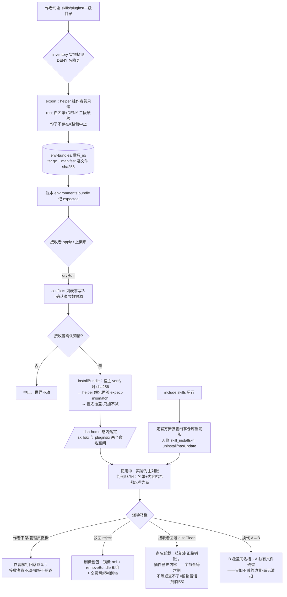

# 现状说明：存储格局与随行包流程（2026-10-31 定格）

> 本文档为实物采集后的现状快照；判例编号见 docs/fixlog.md。

## 一、全局存储格局（账实两域）

```
┌─────────────────────────── 账本域 ───────────────────────────┐
│  MongoDB dsh_prod @127.0.0.1:27018（副本集 dsh-rs，单轨）      │
│  users(3)·environments(7)·credentials(5)·sessions(5·TTL)      │
│  audit(515·全案卷)·skills(2)·skill_installs(2)·cwt·usage·meta │
│  规则：VC 为权威账为兜底；票存 sha256 不存明文；吊销单事务写确认 │
└──────────────────────────────────────────────────────────────┘
┌─────────────────────────── 实物域 ───────────────────────────┐
│  Docker                                                         │
│   · 命名卷 dsh-data-swtc-<地址> → 容器 /dsh-home               │
│     （凭据/settings/sessions/skills/plugins——租户身家，        │
│       容器销毁卷保留；换代前整卷备份）                          │
│   · bind ro  patches/swtc-<地址>.yml → /patches/tenant.patch.yml│
│   · 镜像 dsh-multitenant:env-<addr8>-<slug>-<ts>（上传产物本体） │
│  宿主 data/                                                     │
│   · workspace-snapshots/  三件套：active 槽 ws-<addr>.tar（建后  │
│     自动合回）+ archived 槽 ws-<addr>-<ts>.archived.tar（只存    │
│     不合，回退=干净默认的去处）                                   │
│   · env-bundles/<模板 _id>/  bundle.tar.gz + manifest.json       │
│   · skills/  市场技能正文（元数据在 mongo，正文留磁盘=合同边界）  │
│   · backups/ 换代前整卷备份 tgz；keys/ logs/ npm-cache/          │
│   · config/*.json、installs.json：文件时代残留（单轨下不显形，    │
│     跨轨清扫机制防回切复活——判例 52）                             │
└──────────────────────────────────────────────────────────────┘
浏览器：user_session cookie（httpOnly·单源一张票·半衰滑动续期）；
localStorage 仅非敏感指针（swtc_address 等）。
```

## 二、随行包生命周期（流程图·mermaid）



## 三、撞名判定速查

| 撞法                            | 裁决                                                                                                                           |
| ------------------------------- | ------------------------------------------------------------------------------------------------------------------------------ |
| `skills/foo` vs `plugins/foo`   | 两个命名空间，不相撞（root 白名单两道硬验）                                                                                    |
| 包内文件 vs 卷内已有            | 两段式知情覆盖：dryRun 报 conflicts → 确认 → 覆盖；永不删                                                                      |
| 两包内容相同                    | 不去重（一模板一包，tag 含秒级时间戳独槽）；sha256 只管完整性不管省空间                                                        |
| 跨模板同名（A 装后 B 装）       | 同槽 last-wins；技能=账本制可查可比；插件=无账文件拷贝                                                                         |
| 退场清扫 vs 用户自装/自写同名件 | **删护内容（判例 55）**：manifest 字节指纹全等才删；不等=别人占的槽，留物留话；查不了=不代删                                   |
| 插件出身（自写/GitHub/官网）    | 落卷字节无别、出身隐形——**声明不免责**：向导自述 provenance 入账供审核与使用者参考，搬运照样受审                               |
| 同名模板重传                    | 生成全新模板（旧模板及在用最不受影响，账本建议上架后撤旧）                                                                     |
| 技能与插件语义差                | 技能：点名引用仓库当前版、有账（uninstall/hasUpdate/对账销幽灵）；插件：文件拷贝、无账——退场时**删护内容**（判例 55 字节核对） |

## 四、当前边界与在册待办（如实）

1. **换代残留**（上表 R 支）：旧模板独有文件无清扫机制（判例 55 已护住「误伤用户自装件」这半，残留清退本身未做）；技能面删护内容（用 installedHash 核对）列为续账。
2. **空间 GC**（PR5 欠账）：workspace-snapshots 177MB（13 份）、backups 9.4MB、env 镜像 3×1.53GB（含演练件）；revoked>7d rmi 与快照 GC 未做。
3. **市场旧垃圾**：jndw 名下 `evil-skill` 等 8 月测试件仍在架（published 2 条之一），等用户点名清理。
4. **文件时代死账**：config/sessions.json、installs.json 等残留不再显形（跨轨清扫兜底），可择机归档删除。
5. 本地 30+ commit 未 push；部署（192.168.66.58）与雷达实弹循环仍挂起。
